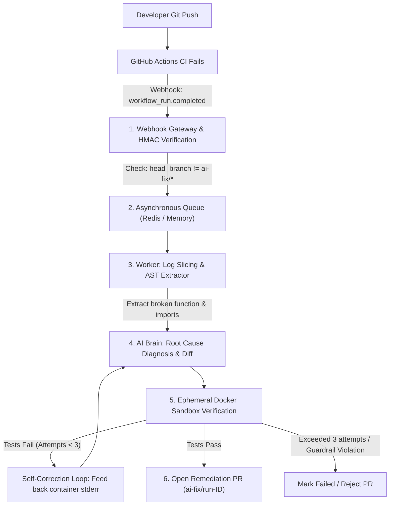

# Patchwork: CI Failure Remediation

[](file:///D:/Project/Patchwork/tests)
[](file:///D:/Project/Patchwork)
[](https://fastapi.tiangolo.com)
[](https://www.docker.com)
[](file:///D:/Project/Patchwork/LICENSE)

> Patchwork receives failed GitHub Actions runs, isolates the failing function, asks an LLM for a minimal patch, and verifies it in a sandbox. A pull request opens only when the tests pass.

---

## 1. How the system works



1. **Trigger & Ingestion**: A push to GitHub fails CI (`workflow_run.completed`). GitHub fires a signed webhook (`X-Hub-Signature-256`) to the Patchwork Gateway.
2. **Queueing**: The gateway verifies HMAC authenticity, ensures the failure didn't happen on an AI-created branch (infinite loop prevention), and drops the job into an asynchronous Redis queue.
3. **Context Gathering & Log Slicing**: A worker downloads raw logs, strips ANSI escape codes and runner setup noise, locates the exact traceback frame, and uses an **AST Parser** to extract *only* the broken function and its module imports instead of sending thousands of lines of context.
4. **AI Diagnosis & Patching**: The isolated traceback, target function, and error context are sent to an LLM (Gemini / OpenAI / Mock) to diagnose the root cause and generate a unified diff.
5. **Sandboxed Verification (The Self-Correction Loop)**: The worker spins up an isolated, resource-capped Docker container (`python:3.11-slim`), applies the diff, and runs the test suite. If the test fails, it takes the container output and feeds it back to the LLM for reflection (up to 3 attempts).
6. **Resolution (Pull Request)**: Once verified, Patchwork branches off `ai-fix/run-<run_id>`, commits the patch, and opens a pull request with proof that all tests passed.

---

## 2. Guardrails

| Guardrail | Purpose | Implementation |
| :--- | :--- | :--- |
| **1. The "Never Touch Tests" Rule** | Prevents the AI from cheating by deleting test assertions or modifying CI configs. | [patchwork/guardrails/rules.py](file:///D:/Project/Patchwork/patchwork/guardrails/rules.py): Rejects patches modifying `/tests`, `test_*.py`, `*_test.py`, or `.github/workflows/`. |
| **2. Infinite Loop Prevention** | Stops the bot from triggering itself into an infinite, API-credit-burning loop when its own PR runs CI. | [patchwork/gateway/webhook.py](file:///D:/Project/Patchwork/patchwork/gateway/webhook.py): Evaluates `head_branch` at the gateway. Ignores any branch prefixed with `ai-fix/*` or triggered by bot accounts. |
| **3. Flaky Test Detection** | Avoids rewriting code for transient network drops, database resets, or rate limits. | [patchwork/guardrails/flaky.py](file:///D:/Project/Patchwork/patchwork/guardrails/flaky.py): Detects `ETIMEDOUT`, `ECONNRESET`, 502/503/504, and automatically triggers GitHub Actions "Re-run jobs" instead of code diffing. |
| **4. Diff Size Limiter** | Prevents the AI from rewriting entire files. | [patchwork/guardrails/rules.py](file:///D:/Project/Patchwork/patchwork/guardrails/rules.py): Automatically measures additions + deletions in unified diff. Rejects any patch altering > 30 lines. |

---

## 3. Core components

### Component A: The GitHub App & Webhook Gateway
- **FastAPI** asynchronous application listening at `/api/v1/webhook`.
- Verifies SHA256 HMAC digest in `X-Hub-Signature-256`.
- Authenticates using RS256 JWTs with GitHub App private key, exchanging for an Installation Access Token.

### Component B: The Asynchronous Task Queue
- Dual-mode architecture in [patchwork/queue/broker.py](file:///D:/Project/Patchwork/patchwork/queue/broker.py).
- Backed by **Redis** (`RPUSH`/`BLPOP`) for production scalability, with an automatic **Async In-Memory Queue** fallback for local development and offline testing.

### Component C: The Log & AST Extractor
- [patchwork/extractor/cleaner.py](file:///D:/Project/Patchwork/patchwork/extractor/cleaner.py): Strips ANSI colors (`\x1b[...]`), ISO-8601 CI timestamps, and GitHub runner headers.
- [patchwork/extractor/parser.py](file:///D:/Project/Patchwork/patchwork/extractor/parser.py): Locates Python/Pytest stack frames and separates application source code from test runner frames.
- [patchwork/extractor/ast_extractor.py](file:///D:/Project/Patchwork/patchwork/extractor/ast_extractor.py): Uses Python `ast.parse` to traverse the AST, extracting only the enclosing broken function/method and all module imports.

### Component D: The Ephemeral Sandbox Manager
- [patchwork/sandbox/docker_manager.py](file:///D:/Project/Patchwork/patchwork/sandbox/docker_manager.py): Talks directly to the Docker engine API.
- Enforces strict constraints: **0.5 vCPU quota**, **512MB RAM**, **network disabled**, and a **120-second timeout** to protect against infinite loops. Disposable containers are removed in a `finally:` block.
- Automatic isolated subprocess fallback ([patchwork/sandbox/local_runner.py](file:///D:/Project/Patchwork/patchwork/sandbox/local_runner.py)) when Docker Desktop is inactive.

### Component E: The Observability UI (Frontend)
- Multi-page UI served at `http://localhost:8000/`, styled after GitHub's Primer design language.
- Public landing page with sign in and one-time administrator registration. The dashboard is behind a login; webhook delivery stays public.
- Pages: **Overview** (metrics, recent activity, system health), **Jobs** (filterable list), **Job detail** (root cause, unified diff, sandbox attempts), **Guardrails**, and **Settings**.
- Integration credentials, sandbox limits, and guardrails can be edited in Settings. Values are stored in the database and applied without restarting.
- Light and dark color modes, GitHub-style diff rendering, and ICO/PNG/SVG favicons.
- Reads only persisted pipeline jobs and configured system state. Jobs enter through the signed GitHub webhook or the real pipeline.

---

## 4. Quickstart

### 1. Prerequisites & Installation
```bash
# Clone and enter directory
cd D:\Project\Patchwork

# Create and activate virtual environment
python -m venv .venv
.venv\Scripts\activate   # Windows
# source .venv/bin/activate # Linux/macOS

# Install dependencies
pip install -r requirements.txt
```

### 2. Run the Full Test Suite
```bash
.venv\Scripts\pytest -v
```
*Covers AST parsing, log slicing, guardrails, diff application, webhook verification, and the dashboard pages/API. Tests use a temporary database.*

### 3. Start the Web Server
```bash
.venv\Scripts\uvicorn patchwork.gateway.app:app --host 0.0.0.0 --port 8000
```
Open **[http://localhost:8000](http://localhost:8000)** for the landing page. The first account is the administrator; later registrations stay closed unless `ALLOW_REGISTRATION=true` is set. Sign in, then use the header navigation for Overview, Jobs, Guardrails, and Settings. The Settings page replaces manual `.env` edits for the GitHub credentials, LLM keys, webhook secret, sandbox limits, and guardrails. Stored secrets stay masked until you confirm your account password.

---

## 5. Repository layout

```text
Patchwork/
├── patchwork/
│   ├── config.py              # Pydantic Settings & environment variables
│   ├── database.py            # Async SQLite / PostgreSQL session manager
│   ├── models.py              # SQLAlchemy 2.0 & Pydantic domain models
│   ├── settings_store.py      # Dashboard-editable settings (database-backed)
│   ├── pipeline.py            # Pipeline orchestrator
│   ├── gateway/               # Component A: GitHub App Webhook Gateway
│   │   ├── app.py             # FastAPI entrypoint
│   │   ├── webhook.py         # Webhook handler & event router
│   │   └── security.py        # HMAC-SHA256 signature verifier
│   ├── queue/                 # Component B: Asynchronous Message Queue
│   │   ├── broker.py          # Redis client with in-memory fallback
│   │   └── worker.py          # Background task worker
│   ├── extractor/             # Component C: Log & AST Extractor
│   │   ├── cleaner.py         # ANSI escape & CI timestamp stripper
│   │   ├── parser.py          # Traceback & crash location isolator
│   │   └── ast_extractor.py   # AST-based function & import extraction
│   ├── brain/                 # AI Diagnosis & Patch Engine
│   │   ├── llm.py             # Gemini, OpenAI, and Mock LLM client
│   │   ├── prompts.py         # Multi-turn diagnosis & reflection prompts
│   │   └── patcher.py         # Unified diff parser & context applier
│   ├── guardrails/            # Patch safety checks
│   │   ├── rules.py           # Never Touch Tests, Infinite Loop, Diff Limiter
│   │   └── flaky.py           # Flaky test / network timeout detector
│   ├── sandbox/               # Component D: Ephemeral Sandbox
│   │   ├── docker_manager.py  # Disposable container manager (limits: 0.5 CPU, 512MB)
│   │   ├── local_runner.py    # Isolated subprocess runner fallback
│   │   └── verifier.py        # 3-strike self-correction loop coordinator
│   ├── github/                # GitHub App & PR Automation
│   │   └── client.py          # JWT authentication, commits, and PR creator
│   └── dashboard/             # Component E: Observability UI
│       ├── api.py             # Read-only metrics & job API
│       ├── pages.py           # Overview / Jobs / Guardrails / Settings routes
│       ├── templating.py      # Jinja filters, status metadata, system state
│       ├── static/            # GitHub-style CSS, theme JS, ICO/PNG/SVG icons
│       └── templates/         # base + focused page templates
├── tests/                     # Automated pytest test suite
│   ├── test_ast_extractor.py
│   ├── test_cleaner_and_parser.py
│   ├── test_end_to_end_pipeline.py
│   ├── test_guardrails.py
│   ├── test_patcher.py
│   ├── test_webhook_gateway.py
│   ├── test_dashboard_ui.py
│   └── conftest.py            # Isolated test database

├── Dockerfile                 # Production container image
├── docker-compose.yml         # Gateway + Worker + Redis composition
├── pytest.ini                 # Pytest configuration
├── requirements.txt           # Project dependencies
└── README.md                  # System architecture & documentation
```

---

## 6. Development roadmap

- [x] **Phase 1: GitHub Integration & Log Extraction (Week 1)**
  - Dummy repository with intentional ZeroDivisionError and Pytest workflow.
  - Webhook gateway with HMAC-SHA256 signature verification.
  - ANSI stripper and traceback frame isolator.
- [x] **Phase 2: The AI Brain & PR Automation (Week 2)**
  - AST-based function and import extractor.
  - Multi-provider LLM diagnosis engine (Gemini / OpenAI / Mock).
  - Git branch synthesis (`ai-fix/run-ID`) and Pull Request formatting.
- [x] **Phase 3: The Docker Sandbox & Reflection Loop (Week 3)**
  - Docker container manager with strict CPU (0.5 vCPU), RAM (512MB), and 120s timeout limits.
  - 3-strike self-correction loop feeding container failure output back to LLM.
- [x] **Phase 4: Safety Guardrails & Observability UI (Week 4)**
  - Four guardrails: "Never Touch Tests", "Infinite Loop Prevention", "Flaky Test Detection", "Diff Size Limiter".
  - Observability UI with focused Overview, Jobs, Job detail, Guardrails, and Settings pages backed only by persisted pipeline data.
